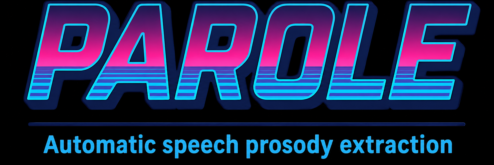

> **Datos / Data:** El ejemplo distribuido y CI son totalmente sintéticos, sin grabaciones humanas. Los vídeos reales se procesan localmente y no se suben; las evaluaciones reales publicables se limitan a TabErrans. / The distributed example and CI are fully synthetic, with no human recordings. Real videos remain local; publishable real-data evaluations are limited to TabErrans.

## Actualización local · 2026-11-16 / Local update

### Interpolación cúbica: coherencia entre método y código

La documentación original describía la interpolación cúbica por tramos de
**Fritsch–Butland**, pero el código seleccionaba `splinefun(method = "fmm")`.
En R, `fmm` corresponde a **Forsythe–Malcolm–Moler**: son algoritmos distintos.
Esta actualización alinea la implementación con el método descrito mediante
PCHIP (Hermite cúbico por tramos), con pendientes interiores de Fritsch–Butland
y condiciones de extremo unilaterales. Se implementa en R base, sin añadir una
dependencia de ejecución; SciPy se utiliza exclusivamente como referencia en tests.

Se evalúa la curva en los timestamps reales de ffprobe, conservando una fila
por fotograma. Los huecos entre observaciones siguen recibiendo estimaciones;
no se introduce el corte de 0,1 s ni la interpolación lineal de Daedalus.
Fuera del rango medido se prolonga el polinomio cúbico del primer/último tramo,
para conservar cobertura en los bordes. La propiedad de no sobreoscilación
se aplica dentro del rango medido, no a esa extrapolación. Una pista ausente o
con menos de cuatro observaciones válidas sigue produciendo `NA`, como antes.
La regla existente que lleva pitch menor de 10 Hz a cero se conserva.

El PDF histórico `_book/Parole--Ecosistema-Funcional.pdf`, sección 5.5.4,
confunde ambos nombres y atribuye a `fmm` garantías que no ofrece. Esta nota
corrige esa atribución; PCHIP es continuo con primera derivada continua (C1),
pero su segunda derivada puede cambiar entre tramos. No es un spline C2.

**EN:** The original documentation intended Fritsch–Butland interpolation,
but the implementation selected R's `fmm` (Forsythe–Malcolm–Moler).
We now use explicit piecewise cubic Hermite interpolation (PCHIP), with
Fritsch–Butland interior derivatives and one-sided endpoint slopes. Real
ffprobe frame timestamps, gap estimates and cubic endpoint extrapolation are
preserved. There is no linear replacement or 0.1-second gap cutoff. Shape
preservation applies within the measured range, not outside it. Missing tracks
or fewer than four valid observations still yield `NA`; the existing pitch
below 10 Hz rule is unchanged. The historical PDF's method attribution and
smoothness statements are superseded by this clarification (PCHIP is C1).

References: [Fritsch–Butland, 1984](https://doi.org/10.1137/0905021),
[SciPy PCHIP algorithm and endpoint scheme](https://docs.scipy.org/doc/scipy/reference/generated/scipy.interpolate.PchipInterpolator.html),
[R splinefun methods](https://stat.ethz.ch/R-manual/R-devel/library/stats/html/splinefun.html).

### Praat barren 6.4.60

El instalador fija y verifica **Praat barren 6.4.60**, desde la
[release histórica oficial](https://github.com/praat/praat.github.io/releases/tag/v6.4.60),
para Linux Intel64 y ARM64. Usa `env/praat/praat` aunque exista otro Praat global.
**EN:** The installer pins and verifies the local Praat barren 6.4.60 binary
from the official historical release, independently of system Praat.

### Silero VAD local CPU

Las dependencias CUDA agotaban el espacio de CI; la inferencia CPU funciona
localmente. Instalar en el entorno que utiliza el pipeline:
**EN:** CPU inference works locally; CUDA dependencies previously exhausted
CI disk space. Install into the environment used by the pipeline:

```bash
[ -d env/pyenv ] || python3 -m venv env/pyenv
env/pyenv/bin/python -m pip install -r requirements_silero_cpu.txt
env/pyenv/bin/python -m pip install -r requirements_silero_local.txt
```

El runner lee WAV mono de 16 kHz mediante SoundFile. El modelo Silero se descarga
con Torch Hub al primer uso; su referencia `master` aún no está fijada.
The runner reads normalized mono 16 kHz WAV with SoundFile. Torch Hub downloads
the model on first use; the Silero `master` reference is not pinned.

El CI del fork instala estas dependencias CPU, contrasta la cúbica de R con
SciPy y comprueba la salida VAD en un vídeo sintético. No ejecuta las pruebas de
interpolación lineal de Daedalus. / Fork CI installs CPU dependencies, checks
R cubic results against SciPy and verifies VAD output on a synthetic video.

### Ejemplo sintético trazable / Traceable synthetic example

[Escuchar / Listen: synthetic_en.wav](tests/fixtures/synthetic_en.wav).
El WAV aprobado tiene 11,0979375 s, mono PCM de 16 bits a 16 kHz. Contiene
silencios, tonos de 220 y 440 Hz, un barrido de 180 a 360 Hz y la frase
“This is a synthetic voice for testing Parole. One, two, three.” generada por
la voz estándar `en-us` de eSpeak NG, sin clonación ni grabaciones humanas.

[Manifest](tests/fixtures/synthetic_en.json): SHA-256, cronología, parámetros y
versiones de generación. CI usa ese WAV fijo y comprueba su hash; no regenera
la voz con una versión distinta del sintetizador. La receta está en
`scripts/generate_synthetic_fixture.py`. La regeneración con las versiones
registradas se comprobó idéntica byte a byte.

**EN:** The fixed fixture contains mathematical tones, a chirp and standard
eSpeak NG English speech. Its manifest records the checksum, timeline, settings
and generation tools. CI verifies the fixed input, builds a black-frame video,
checks frame alignment, the known pitches, chirp tracking and VAD on synthetic
speech/silence, then saves only synthetic results and execution provenance.
This is a smoke test, not a human-speech accuracy benchmark. Model loading and
warm inference times are not benchmarked by this CI example.

From the repository root / Desde la raíz del repositorio:

```bash
mkdir -p resultados
ffmpeg -v error -f lavfi -i color=c=black:s=320x240:r=30 \
  -i tests/fixtures/synthetic_en.wav -c:v mpeg4 -q:v 5 -pix_fmt yuv420p \
  -c:a aac -b:a 128k -shortest resultados/synthetic_en.mp4
bash scripts/parole.sh resultados/synthetic_en.mp4 resultados --parquet
env/pyenv/bin/python tests/validate_synthetic_output.py
```

La validación requiere las dependencias de Silero descritas arriba y
`env/pyenv/bin/python -m pip install -r requirements_test.txt`.
Regeneración opcional (requiere eSpeak NG y FFmpeg):
`python scripts/generate_synthetic_fixture.py --output resultados/regenerated.wav`.
El WAV original se mantiene fijo; los resultados y vídeos generados permanecen
en `resultados/`, excluido de Git. Todas las rutas anteriores son relativas al
repositorio. No hay rutas personales ni vídeos reales necesarios para CI.

[➡️ English Version](#english)

<p align="center">
  
</p>

<p align="center">
  <strong style="font-size: 2em;">PAROLE</strong><br>
  <span style="font-size: 1.2em;">Extracción automática de prosodia del habla</span>
</p>

<p align="center">
<a href="https://doi.org/10.5281/zenodo.15522925">
  

<a href="https://github.com/bHerreno/parole/actions/workflows/parole-ci.yml">
  


</p>

> **Consulta** [CHANGELOG.md](./CHANGELOG.md) **para ver los cambios recientes.**

## 🛠️ Descripción

**PAROLE** es un pipeline automatizado para la extracción de información prosódica del habla (pitch, intensidad, formantes, harmonicidad, y detección de actividad vocal mediante VAD) desde vídeos. Utiliza herramientas estándar como Praat, Python, R y Silero-VAD, proporcionando resultados en formatos CSV o Parquet.

---


## 📘 Manual técnico

Puedes consultar el manual completo de PAROLE en el siguiente enlace:

📄 [Manual técnico (PDF, español)](./_book/Parole--Ecosistema-Funcional.pdf)

Este documento incluye fundamentos teóricos, justificación metodológica, y detalles técnicos sobre la arquitectura, herramientas, scripts y formatos de salida.


## 📁 Estructura del Proyecto

```
├── tests
│   └── fixtures
│       ├── synthetic_en.wav
│       └── synthetic_en.json
├── images 
│   └── logo_parole.png
├── install_parole.sh
├── requirements_python.txt
├── resultados
│   └── video_ejemplo1
│       ├── video_ejemplo1_prosody.csv
│       └── video_ejemplo1_prosody.parquet
└── scripts
    ├── extract_prosody.praat
    ├── parole_batch.sh
    ├── parole.sh
    ├── process_prosody.R
    └── silero_vad_runner.py
```

---

## ⚙️ Instalación

Ejecuta en una terminal desde la raíz del proyecto:

```bash
bash install_parole.sh
```

Esto creará los entornos de Python y R necesarios, instalará Praat barren 6.4.60 localmente y configurará las dependencias base. Para Silero, instala además los requisitos CPU y locales indicados arriba.

---

## 🚀 Ejecución

### Procesar un único vídeo

```bash
mkdir -p resultados
./scripts/parole.sh "ruta/a/mi_video.mp4" resultados/ --parquet
```

### Procesar múltiples vídeos (batch)

```bash
./scripts/parole_batch.sh data/videos/ resultados/ --parquet
```

---

## 📖 Dependencias clave

Este proyecto requiere las siguientes herramientas y librerías en distintos entornos:

- **Praat** — Interfaz de línea de comandos (CLI), incluye la versión *barren* utilizada para la extracción prosódica  
- **FFmpeg / FFprobe** — Para la gestión de audio/vídeo y alineación de timestamps

### 🐍 Python

- [`torch`](https://pytorch.org/) — Librería principal de deep learning usada por Silero VAD  
- [`torchaudio`](https://pytorch.org/audio/stable/) — Utilidades de procesamiento de audio para PyTorch  
- [`pandas`](https://pandas.pydata.org/) — Manipulación y gestión de datos  

### 📦 R

- [`arrow`](https://cran.r-project.org/package=arrow) — Usado para guardar los datos prosódicos finales en formato `.parquet`  


---

## 🔁 GitHub Actions

Este repositorio cuenta con un test automático en GitHub Actions que verifica:

- Instalación del entorno completo (Python, R, Praat)
- Ejecución del script `parole.sh` sobre el vídeo sintético de prueba
- Verificación del archivo de salida en `.parquet`

Para más detalles, consulta el archivo del workflow de CI:
[`parole-ci.yml`](.github/workflows/parole-ci.yml).

---

## 💬 Contactos

- **Responsable del fork / Dirección del proyecto:**  
  Brian Herreño Jiménez  
  Email: brian.herreno@gmail.com  

- **Proyecto upstream (repositorio original):**  
  daedalusLAB / PAROLE  
  Repositorio: https://github.com/daedalusLAB/parole  
  Contacto original: Cristóbal Pagán Cánovas (daedalusLAB)

---

## 📜 Licencia

Este proyecto se distribuye bajo la licencia [GPL-3](https://www.gnu.org/licenses/gpl-3.0.html).

---

## 📌 Autoría y financiación

**PAROLE** fue desarrollado originalmente por **Daedalus Lab** como parte del proyecto **MULTIFLOW**, financiado por el Ministerio de Ciencia, Innovación y Universidades de España.

Este repositorio es un **fork independiente** mantenido por **Brian Herreño Jiménez**.  
Cualquier modificación, extensión o mantenimiento realizado en este fork **no está afiliado ni respaldado por Daedalus Lab ni por el proyecto MULTIFLOW**.


---

<a id="english"></a>

[➡️ Versión en Español](#parole-extracción-automática-de-prosodia-del-habla)

# 📌 PAROLE: Automatic Speech Prosody Extraction

> **See** [CHANGELOG.md](./CHANGELOG.md) **for the latest fixes.**  

## 🛠️ Description

**PAROLE** is an automated pipeline for extracting speech prosodic information (pitch, intensity, formants, harmonicity, and Voice Activity Detection via VAD) from videos. It leverages standard tools like Praat, Python, R, and Silero-VAD, providing results in CSV or Parquet formats.

---

📘 A technical manual (in Spanish) is available here: [Parole--Ecosistema-Funcional.pdf](./_book/Parole--Ecosistema-Funcional.pdf)


## 📁 Project Structure

```
├── tests
│   └── fixtures
│       ├── synthetic_en.wav
│       └── synthetic_en.json
├── images
│   └── logo_parole.png
├── install_parole.sh
├── requirements_python.txt
├── resultados
│   └── video_ejemplo1
│       ├── video_ejemplo1_prosody.csv
│       └── video_ejemplo1_prosody.parquet
└── scripts
    ├── extract_prosody.praat
    ├── parole_batch.sh
    ├── parole.sh
    ├── process_prosody.R
    └── silero_vad_runner.py
```

---

## ⚙️ Installation

Run from a terminal at the project's root:

```bash
bash install_parole.sh
```

This will set up necessary Python and R environments, install Praat barren 6.4.60 locally, and configure the base dependencies. For Silero, also install the CPU and local requirements listed above.

---

## 🚀 Usage

### Single video processing

```bash
mkdir -p resultados
./scripts/parole.sh "path/to/my_video.mp4" resultados/ --parquet
```

### Batch video processing

```bash
./scripts/parole_batch.sh data/videos/ resultados/ --parquet
```

---
## 📖 Key Dependencies

This project requires the following tools and libraries across different environments:

- **Praat** — Command-line interface (CLI), includes the *barren* version used for prosodic extraction  
- **FFmpeg / FFprobe** — For audio/video alignment and timestamp management

### 🐍 Python

- [`torch`](https://pytorch.org/) — Core deep learning library used by Silero VAD  
- [`torchaudio`](https://pytorch.org/audio/stable/) — Audio processing utilities for PyTorch  
- [`pandas`](https://pandas.pydata.org/) — Data handling and manipulation  

### 📦 R

- [`arrow`](https://cran.r-project.org/package=arrow) — Used to write the final prosodic data as `.parquet` files  


---

## 🔁 GitHub Actions

This repository includes an automated test in GitHub Actions that checks:

- Installation of the full environment (Python, R, Praat)
- Execution of the `parole.sh` script on the synthetic test video
- Verification of the `.parquet` output file


For more details, see the CI workflow file:
[`parole-ci.yml`](.github/workflows/parole-ci.yml).

---

## 💬 Contacts

- **Fork maintainer / Project lead:**  
  Brian Herreño Jiménez  
  Email: brian.herreno@gmail.com  

- **Upstream project (original repository):**  
  daedalusLAB / PAROLE  
  Repository: https://github.com/daedalusLAB/parole  
  Original contact: Cristóbal Pagán Cánovas (daedalusLAB)


---

## 📜 License

This project is distributed under the [GPL-3 License](https://www.gnu.org/licenses/gpl-3.0.html).

---

## 📌 Authorship and Funding

**PAROLE** was originally developed by **Daedalus Lab** as part of the **MULTIFLOW** project, funded by the Ministry of Science, Innovation, and Universities of Spain.

This repository is an **independent fork** maintained by **Brian Herreño Jiménez**.  
Any modifications, extensions, or maintenance performed in this fork are **not affiliated with nor endorsed by Daedalus Lab or the MULTIFLOW project**.

