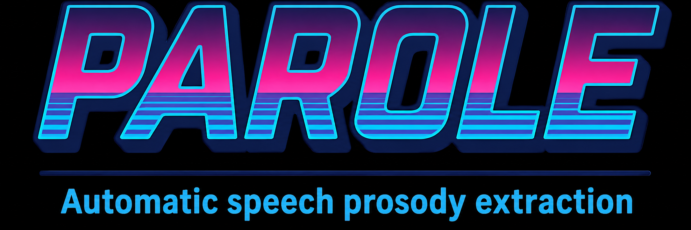

<p align="center">
  
</p>

<p align="center">
  <a href="https://doi.org/10.5281/zenodo.15522925">
    
  </a>
  <a href="https://github.com/bHerreno/parole/actions/workflows/parole-ci.yml">
    
  </a>
</p>

Extrae medidas prosódicas y actividad de voz de vídeo MP4 o audio WAV mediante Praat, FFmpeg, R y Silero VAD opcional.

[English / instrucciones completas](../README.md) · [Historial de cambios](../CHANGELOG.md)

## Instalación y uso

El instalador está orientado a Linux x86-64 y ARM64. Requiere Python 3 con venv/pip, R, FFmpeg/ffprobe, curl y tar; algunas dependencias de R necesitan bibliotecas de desarrollo del sistema. El [workflow de CI](../.github/workflows/parole-ci.yml) muestra una instalación probada en Ubuntu.

Desde la raíz del repositorio:

```bash
bash install_parole.sh
# VAD opcional en CPU:
env/pyenv/bin/python -m pip install -r requirements_silero_cpu.txt
env/pyenv/bin/python -m pip install -r requirements_silero_local.txt
mkdir -p resultados
bash scripts/parole.sh "ruta/al/video.mp4" resultados --parquet
bash scripts/parole.sh "ruta/al/audio.wav" resultados
bash scripts/parole_batch.sh "ruta/a/videos" resultados --parquet
```

La salida predeterminada es CSV. El procesamiento por lotes busca MP4 recursivamente. El instalador fija y verifica **Praat barren 6.4.60** de la release histórica oficial, en `env/praat/praat`, independientemente del Praat del sistema.

Silero funciona en CPU y se comprueba en CI. SoundFile evita la dependencia de TorchCodec para leer el audio. La primera ejecución necesita internet para descargar el modelo desde Torch Hub. El modelo sigue actualmente la rama `master` de `snakers4/silero-vad`, sin fijar una versión; el informe sintético registra su hash.

## Método y uso en investigación

La interpolación del pipeline se ejecuta en **R** (`scripts/interpolate_cubic.R`). SciPy solo se usa en las pruebas de regresión como referencia numérica independiente; no realiza la interpolación del procesamiento habitual.

Se emplea **PCHIP**, interpolación de Hermite cúbica por tramos con pendientes interiores de Fritsch–Butland y pendientes unilaterales en los extremos. Se mantiene provisionalmente mientras se evalúa cómo afecta la sobreoscilación de FMM a los resultados.[^metodo]

PCHIP es **C1**: conserva la continuidad de la curva y su primera derivada, pero la segunda puede saltar en los nodos. Evita sobreoscilaciones entre observaciones dentro del rango medido; esa garantía no se extiende a la extrapolación cúbica de los extremos.

ffprobe proporciona los tiempos reales de cada fotograma; la interpolación permite evaluar las medidas acústicas en esos tiempos y conservar una fila por fotograma. En WAV se usa una rejilla temporal acústica. Se siguen estimando valores en huecos y fuera de los extremos medidos: no son observaciones adicionales. Con menos de cuatro observaciones válidas se devuelve `NA`; se conserva la regla de convertir pitch inferior a 10 Hz en cero.

[^metodo]: Aclaración metodológica del **16 de noviembre de 2026**. `splinefun(method = "fmm")` implementa Forsythe–Malcolm–Moler, no Fritsch–Butland. FMM es C2, pero puede sobreoscilar según los datos. Un método C2 es necesario si el estudio requiere específicamente continuidad de la segunda derivada; esa propiedad no garantiza por sí sola la validez científica. Por ahora se prefiere PCHIP hasta evaluar las consecuencias de la sobreoscilación. La segunda derivada temporal del pitch en Hz se expresa en Hz/s² y describe cómo cambia su pendiente, no la aceleración física de las cuerdas vocales. El manual incorpora esta aclaración en la discusión metodológica y en una nota al pie fechada.

## Ejemplo y comprobaciones

El [WAV incluido](../tests/fixtures/synthetic_en.wav) contiene tonos, un chirp y voz sintetizada en inglés, sin grabaciones humanas. El [manifiesto](../tests/fixtures/synthetic_en.json) registra hash, cronología y parámetros. La [guía en inglés](../README.md#reproduce-the-synthetic-example) contiene los comandos completos para reproducir CI.

CI contrasta la interpolación con SciPy, comprueba la alineación de fotogramas, los tonos y el chirp conocidos y la detección de voz sintética. Publica únicamente el Parquet sintético y un informe JSON con hashes y versiones. Este ejemplo no establece la precisión para cualquier grabación.

**Datos de evaluación:** El ejemplo distribuido y CI utilizan datos sintéticos. Puedes evaluar tus propias grabaciones y aportar otros conjuntos de datos o resultados si tienes los derechos y consentimientos necesarios para compartirlos. Revisa tanto las grabaciones como los resultados derivados para evitar publicar información identificable.

## Autoría y licencia

PAROLE se desarrolló originalmente en Daedalus Lab dentro de MULTIFLOW, financiado por el Ministerio de Ciencia, Innovación y Universidades de España. Este repositorio es el fork de investigación de **Brian Herreño Jiménez** ([contacto](mailto:brian.herreno@gmail.com)). El proyecto compartido se mantiene en [daedalusLAB/parole](https://github.com/daedalusLAB/parole).

Licencia [GPL-3](https://www.gnu.org/licenses/gpl-3.0.html).
